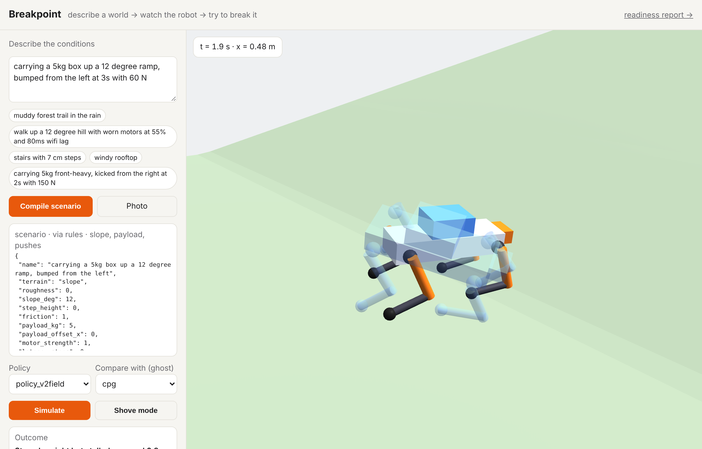
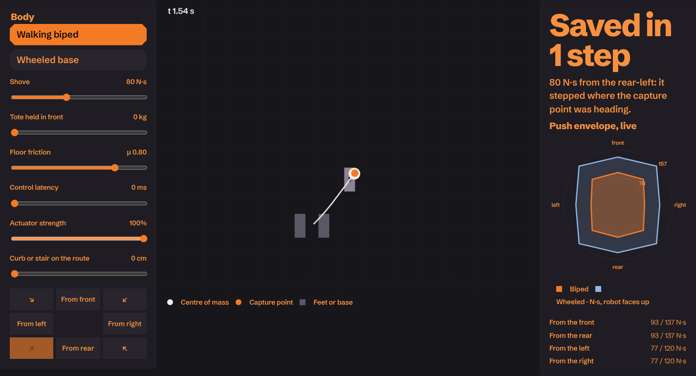
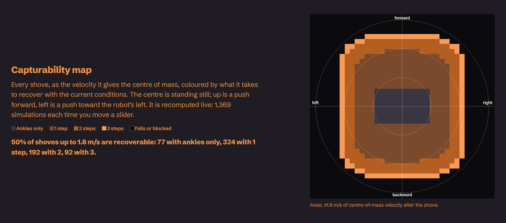
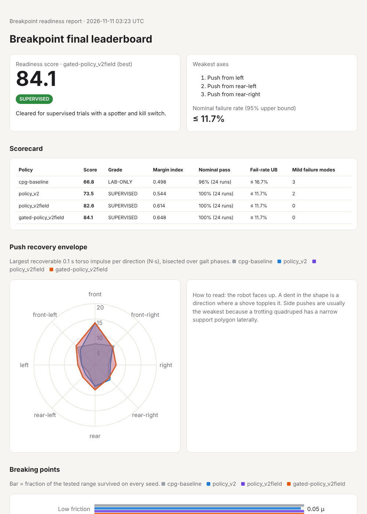
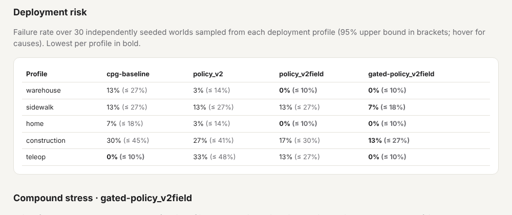
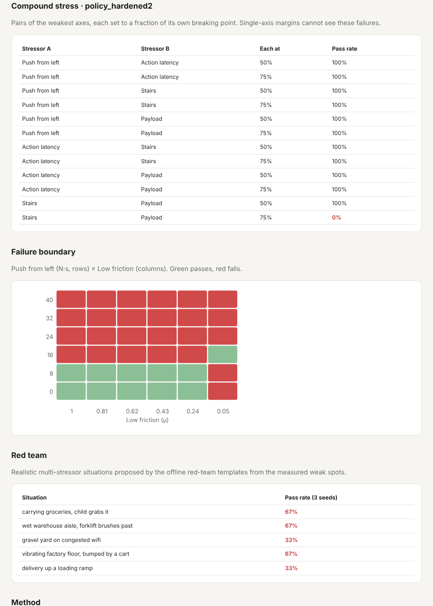

# Breakpoint

**Find where your legged robot breaks before reality does.**

Breakpoint is a CPU-only robustness lab for learned legged-locomotion policies. You can describe a
real place in plain English, or upload a photo of the ground. Breakpoint compiles that into a
validated physics scenario and runs a quadruped through it in MuJoCo. It then:

1. **measures breaking points** on every stress axis,
2. **hunts for the mildest worlds that make the robot fail**,
3. **shrinks each failure** to a minimal counterexample and saves it as a regression test,
4. **retrains the policy** with PPO on those failures,
5. **estimates failure probability** under deployment profiles (warehouse, sidewalk, home,
   construction, teleop),
6. and writes a **readiness report** comparing policies before and after retraining.



## Humanoid push lab

Breakpoint's method also applies to full-size humanoids (`breakpoint/humanoid.py`, `python -m breakpoint humanoid`,
and the browser lab at `/humanoid`):



- **Model.** A 72 kg humanoid balances as a linear inverted pendulum. It recovers from shoves by
  capture-point stepping, bounded by:
  - ankle torque,
  - friction (`|x − p| ≤ μz`),
  - swing time, which grows with payload,
  - leg reach and lateral reach,
  - sensing latency.

  It compensates for slopes by leaning. A tote held in front shifts and raises the combined centre of mass.
- **Biped versus wheeled base.** The wheeled model has a statically stable footprint and drives under its
  capture point. It survives about 1.6× bigger shoves (146 vs 93 N·s from the front), but it cannot climb
  anything taller than a 2.5 cm threshold.
- **Odds by job** (150 sampled shifts each):

  | Job | Biped | Wheeled |
  |---|---|---|
  | Line-side kitting | 0% | 0% |
  | Tote handling | 0.7% | 0% |
  | Trailer unloading | 8.0% (slips) | 16.0% (blocked) |
  | Home care | 0% | 47% |
  | Teleoperated data collection | 2.0% | 0% |

- **Browser parity.** The browser version is a line-for-line JavaScript port, and `tests/test_humanoid_js.py`
  runs it under Node to check it against Python.
- **A bug the map caught.** The capturability map (every shove velocity, coloured by steps needed) showed an
  island at 150 ms of latency: harder shoves were recoverable while softer ones were not. The cause was the
  latency model. Before the delay elapsed, the controller was handed the first *post*-push sample, so it saw
  big shoves instantly. A real controller sees the robot still standing for those first milliseconds. After
  the fix, the region shrinks steadily outward again, and the job odds became less flattering to the biped
  (trailer unloading 0% → 8%). Bisection had missed the bug because it only finds the inner boundary.



## Policy compression with a robustness check

`python -m breakpoint quantize --policy runs/v2field/policy_v2field.npz --gated` compresses the best policy to
FP16 and per-channel INT8, measures action error, then re-audits it:

| Precision | Weights | Mean action error | Readiness | Teleop failures |
|---|---|---|---|---|
| FP32 | 32.3 KB | 0 | 84.1 | 0% |
| FP16 | 16.4 KB | 0.0001 | 84.8 | 0% |
| INT8 | 9.1 KB | 0.002 | 84.1 | 0% |

INT8 is 3.6× smaller at no measured robustness cost. The FP16 row also shows the score's noise floor: a
10⁻⁴ change in actions moved bisection edges by about 0.7 points.

`/roles` maps every specialization a humanoid team hires for to the code and results here.

## Product site

`web/` is the deployable site: a landing page, the hosted lab (`/app`), docs, readiness reports, and
a Python serverless API that runs the same simulator. It is built from `site/` by
`python scripts/build_site.py`. Preview it locally with `python scripts/serve_site.py`
(http://127.0.0.1:3000).

To deploy on Vercel, either:

- **Git:** import this repository in Vercel and set **Root Directory** to `web` (framework:
  Other), or
- **CLI:** run `vercel deploy web --prod`.

Set `SITE_URL=https://<your-domain>` when building so the sitemap and preview-image URLs are
absolute.

## Why

A locomotion policy that looks fine in a demo usually fails somewhere specific: a side shove
during the wrong gait phase, a 60 ms Wi-Fi hiccup, a front-heavy backpack on wet tile. Breakpoint
turns "it looked fine" into numbers you can gate a release on. For example:

- "survives shoves from the left up to 5.6 N·s at the worst gait phase"
- "climbs 20° carrying 8 kg"
- "0 falls in 60 sampled warehouse worlds, so the failure rate is ≤ 4.9% at 95% confidence"
- "fails 35% of teleop worlds, because of control latency"

It does this with no GPU and no PyTorch. The PPO learner is about 150 lines of numpy with
hand-written backprop, and that backprop is checked against finite differences in the tests.

## What's inside

| Module | What it does |
|---|---|
| `scenario.py` | One frozen, validated schema for every world. Every input is clamped to physical bounds: LLM output, HTTP bodies, files and search proposals. It also scores severity and finds the dominant stressor. |
| `world.py` | A procedural 12-DoF quadruped in MJCF, plus heightfield terrain (flat, rough, slope, stairs) and a payload. |
| `env.py` | A 50 Hz policy over 200 Hz physics. The policy outputs a residual on top of a trotting CPG, and PD torques are clipped by motor strength. Also handles action latency, observation noise and timed torso pushes. |
| `nn.py`, `ppo.py` | A numpy MLP, Adam optimizer and clipped-surrogate PPO with GAE and running observation normalisation. The scenario sampler mixes about 50% nominal randomisation, 30% replayed failures and 20% widened ranges. |
| `compiler.py` | Turns language or an image into a Scenario. A rule parser works offline. An optional OpenAI-compatible LLM (Llama API, vLLM, Ollama…) fills a bounded JSON schema and never writes simulator code. Any LLM error falls back to the rules. Photos go through explainable surface cues (texture, glare, colour, banding) or a vision LLM. |
| `probe.py` | Breaking-point bisection on 17 axes: 8 push directions, friction, payload, motor weakness, latency, sensor noise, uphill, downhill, stairs and roughness. Every push is tested at 4 gait phases, and a push margin is only as good as its worst phase. |
| `hunt.py` | Cross-entropy search for the score `margin + λ·severity`, so it finds *cheap* failures. A MAP-Elites atlas keeps the mildest failure per (stressor × severity band) cell. `shrink()` bisects each failure toward nominal, like property-based testing. |
| `redteam.py` | Compound-stress tests (pairs of the weakest axes at 50%/75% of their breaking points), a 2-D failure-boundary heatmap, and an LLM red team that proposes realistic multi-stressor situations from the measured weak spots. Offline, deterministic templates are used instead. |
| `profiles.py` | Deployment profiles (warehouse, sidewalk, home, construction, teleop) as distributions over conditions. `deploy` estimates the failure probability under each, with a 95% bound and the dominant causes. |
| `report.py` | Readiness score (0–100), a grade (FIELD-READY / SUPERVISED / LAB-ONLY / NOT READY), a push-recovery polar plot, breaking-point bars, the failure atlas, and the search budget. Failure-rate bounds use the exact binomial (rule of three) or Wilson. Self-contained HTML. |
| `policy.py` | Policy specs: `cpg`, `*.npz` (residual PPO), `gated:<spec>` (latency-adaptive fallback to the gait), `py:module:factory` (bring your own). |
| `explain.py` | Evidence-based failure explanations, e.g. "Fell 0.7 s after a 12.0 N·s shove from the right: it tipped over with slippery ground (μ=0.20) and a 3.0 kg payload." Every clause is computed from the scenario and outcome. |
| `gym_env.py` | Gymnasium adapter for external RL libraries. |
| `humanoid.py` | Humanoid push recovery: linear inverted pendulum, capture-point stepping, wheeled-base model, job odds. Ported to `site/assets/humanoid.js` and `cpp/capture_point.hpp` with parity tests. |
| `fleet.py` | Fits a site's deployment profile from per-shift telemetry (JSON Lines) with robust quantiles, then re-runs humanoid odds. |
| `hazards.py` | Hazard log with measured frequencies, 95% bounds, a risk matrix, mitigations and verify commands. |
| `quantize.py` | FP16 and INT8 policy compression, profiled and re-audited for robustness. |
| `cli.py` | `compile`, `run`, `train`, `audit`, `harden`, `regress`, `deploy`, `redteam`, `leaderboard`, `serve`, and `certify`. `certify` writes a traceable readiness certificate (policy SHA-256, toolchain versions, git commit, scorecard, margins, deployment risk, search budget) and exits non-zero below `--min-score`. |
| `server.py`, `static/` | FastAPI and a three.js playground. You can compile a scenario, watch the replay, or use **Shove mode**, where you push the robot live over a WebSocket and score how much impulse it absorbs before it falls. A **ghost** mode replays a second policy as a translucent overlay in the same world. |

## Quick start

```bash
pip install -e '.[dev]'
python -m breakpoint compile "icy loading dock, carrying 3kg, shoved hard from the left at 3s"
python -m breakpoint run --text "stairs with 7 cm steps"              # exit code 1 if it fails
python -m breakpoint train --steps 240000 --out runs/policy_v1.npz     # ~5 min on 1 CPU core
python -m breakpoint audit --policy runs/policy_v1.npz --baseline     # report: runs/audit/report.html
python -m breakpoint harden --policy runs/policy_v1.npz --out runs/hardened
python -m breakpoint regress --policy runs/hardened/policy_hardened.npz --suite runs/hardened/suite  # CI gate
python -m breakpoint deploy --policy runs/hardened/policy_hardened.npz --profile warehouse --max-fail 0.10
python -m breakpoint redteam --policy runs/hardened/policy_hardened.npz   # compound + red-team attacks
python -m breakpoint leaderboard cpg runs/policy_v1.npz runs/hardened/policy_hardened.npz
python -m breakpoint certify --policy gated:runs/v2field/policy_v2field.npz --min-score 80   # release gate
python -m breakpoint humanoid --latency-ms 150     # humanoid: biped vs wheeled envelopes and job odds
python -m breakpoint hazards                       # hazard log with measured frequencies
python -m breakpoint fleet --demo "tote handling"  # fit a site profile from shift telemetry, re-run odds
python -m breakpoint quantize --policy runs/v2field/policy_v2field.npz --gated   # INT8 with a robustness check
cmake -S cpp -B build-cpp && cmake --build build-cpp && ./build-cpp/breakpoint_cp bench 2   # C++ controller
python -m breakpoint serve                                            # http://127.0.0.1:8000
pytest -q
```

To use an LLM for scenario compilation (optional):

```bash
export BREAKPOINT_LLM_BASE_URL=https://api.llama.com/compat/v1   # any OpenAI-compatible endpoint
export BREAKPOINT_LLM_API_KEY=...
export BREAKPOINT_LLM_MODEL=<model id>
```

## Headline: best policy so far

**`gated:runs/v2field/policy_v2field.npz` scores 84.1 (SUPERVISED).** The CPG gait alone scores
66.8 in the same audit (`runs/leaderboard3/`). It keeps the learned policy's margins: uphill 20°
and payload 8 kg (both the top of the tested range), stairs 9.4 cm, and shoves from the left /
right of 5.6 / 6.9 N·s at the worst gait phase. It also gets the bare gait's full 120 ms latency
tolerance. Across the five deployment profiles it is best or tied-best everywhere, at 0% failures
in warehouse, home and teleop.

How it was built, in three steps:

1. **v2.** PPO trained from scratch with the corrected learner (bootstrapping on time-limit
   truncation, 16 terrain variants, deterministic best-checkpoint selection) for 420k steps, about
   4 minutes on one CPU core.
2. **v2field.** One deployment-aware hardening round toward the sidewalk and construction profiles.
3. **Latency gate.** The deployment check showed every learned policy failing under control
   latency, while the open-loop CPG (which never reads observations) was immune. A
   latency-specific PPO round did not help: the best-checkpoint guard kept the original. An
   engineering fix did: `gated:` fades the residual out as *measured* link latency rises from 40 ms
   to 80 ms, falling back to the latency-immune gait.

| Policy | Readiness | Margin | Uphill | Payload | Stairs | Latency | Shove from L / R | Compound pairs | Red team fails |
|---|---|---|---|---|---|---|---|---|---|
| CPG gait alone | 66.8 | 0.50 | 9.1° | 3.3 kg | 5.6 cm | 120 ms | 4.4 / 4.4 N·s | 1 | 2–3/5 |
| v1 + hardening round 1 | 77.2 | 0.56 | 16.3° | 6.3 kg | 7.0 cm | 40 ms | 8.8 / 6.3 N·s | 1 | 2/5 |
| v2 (fixed PPO, no hardening) | 73.5 | 0.54 | 9.7° | 8.0 kg | 7.5 cm | 40 ms | 4.4 / 5.0 N·s | 1 | 5/5 |
| v2 + deployment-aware hardening | 82.6 | 0.61 | 20° | 8.0 kg | 9.4 cm | 60 ms | 5.6 / 6.9 N·s | 0 | 2/5 |
| **…+ latency gate** | **84.1** | **0.65** | **20°** | **8.0 kg** | **9.4 cm** | **120 ms** | **5.6 / 6.9 N·s** | 1 | **2/5** |

(Rows 1 and 4–5 are from `runs/leaderboard3/`, rows 2–3 from `runs/leaderboard2/`. Each run
uses identical code, seeds and search budget. Red-team counts for the CPG vary between runs
because the attacks are proposed from each run's own measured weak spots.)



The final leaderboard (`runs/final/report.html`) re-audits CPG, v2, v2field and gated v2field in
one run. It confirms the scores above (66.8 / 73.5 / 82.6 / 84.1) and adds a deployment-risk
table, with 30 worlds per profile:



### Deployment check: "if we ship it there, how often does it fall?"

`python -m breakpoint deploy --policy <p> --trials 60` samples 60 independent worlds from each
deployment profile (a distribution over terrain, friction, payload, latency, noise and pushes).
Every world gets its own seed. The command reports the failure rate with a 95% upper bound and
the dominant causes. It exits non-zero if the bound exceeds `--max-fail`, so it can gate a release.

| Profile | CPG gait | v1 + hardening | v2 | v2field | **gated v2field** |
|---|---|---|---|---|---|
| warehouse | 6.7% (UB 14.0%) | 6.7% | 1.7% | 0.0% | **0.0% (UB 4.9%)** |
| home | 6.7% (UB 14.0%) | 18.3% | 1.7% | 0.0% | **0.0% (UB 4.9%)** |
| sidewalk | 6.7% (UB 14.0%) | 8.3% | 8.3% | 10.0% | **5.0% (UB 11.9%)** |
| construction | 31.7% (UB 42.1%) | 18.3% | 15.0% | 13.3% | **13.3% (UB 22.1%)** |
| teleop (40–100 ms) | **0.0% (UB 4.9%)** | 35.0% | 28.3% | 10.0% | **0.0% (UB 4.9%)** |

What the lab found:

- **Margins and deployment risk disagree, and both matter.** v1 + hardening has strong push
  margins but fails 18% of *home* worlds, all from low friction. The leaderboard's
  single-axis friction margin (0.23) hinted at this; the deployment check measures the cost.
- **Latency is the learned policies' blind spot, and training didn't fix it.** Under teleop
  latency every residual policy fails 10–35% of worlds, all latency-dominated, while the open-loop
  CPG fails 0%. A latency-focused PPO round (`runs/v3lat`) didn't improve the selection score, so
  the guard kept the original. Gating the residual on measured link latency did fix it.
- **v1 looked fine in training but wasn't.** It walked under stochastic training noise but stalled
  when run deterministically, scoring below the bare gait it was built on. That motivated the
  deterministic best-checkpoint selection now built into `train` and `harden`.
- **More hardening isn't always better.** v1's second round (`runs/hardened2`) fixed only 2 of its
  11 counterexamples, and its red-team failures rose from 2 to 5 (76.6 vs 77.2 in
  `runs/leaderboard/`). Its own before/after report showed a small gain; the leaderboard's fresh
  search did not.
- **Compound fragility is real.** Pairs of stressors that each pass alone, at 50–75% of their own
  breaking points, fail together, for example *stairs + payload*. Single-axis reports miss these.
- **The failure boundary has a counter-intuitive pocket.** At friction 0.05 a robot can survive a
  side shove that topples it on concrete, because it slides instead of tripping. On that ice it
  also can't make forward progress at all.



### Conventions

Push directions are named by the side the shove comes **from**, in the robot's frame. The robot
faces +x, and its left is +y. `direction_deg` is the force direction: 0 pushes it forward (from the
rear), +90 pushes it toward its left (from its right). An independent review caught an early
version that had left and right mirrored; the committed results were migrated and a physical
regression test now pins the convention.

## Bring your own policy / library

- **Audit any controller.** `--policy py:package.module:factory` loads `factory()`, which returns
  an `obs -> action` callable or a `Policy`. That covers an SB3 model, an ONNX session or a
  hand-written controller. `examples/my_controller.py` is a lateral-balance reflex. Auditing it
  shows the intuition is only partly right. Compared with the bare gait, it raises the margin for
  shoves from the right (4.4 → 5.0 N·s) and from the rear-left (3.1 → 3.8). It lowers the margin for
  shoves from the left (4.4 → 3.8) and from the rear-right (6.3 → 3.8), and drops payload from
  3.3 kg to 2.3 kg.
- **Train with any RL library.** `breakpoint.gym_env.BreakpointEnv` is a Gymnasium env (it passes
  `check_env`). It reports `terminated` for falls and `truncated` for time limits, and can take a
  `ScenarioSampler` for domain randomisation.

## The hardening loop

```
policy ──► probe (17 axes) ──► hunt (CEM + MAP-Elites atlas) ──► shrink ──► suite/*.json
   ▲                                                                           │
   └──────── PPO fine-tune (30% failure replay) ◄───────────────────────────────┘
                     │
                     └──► re-audit ──► report.html (before vs after) + regress (CI)
```

Each shrunk counterexample is a JSON file with a scenario and seed. `breakpoint regress` replays
the suite on 3 seeds and exits non-zero if any case fails, so a robot's failure history becomes
a unit-test suite.

## Honest limitations

- The robot is a generic 6 kg quadruped, not a calibrated model of any commercial platform. Its
  margins show *relative* robustness, not certified hardware limits.
- CPU training budgets are small (minutes, not billions of steps). A briefly trained residual
  policy can be **worse** than the bare CPG on some axes. The report is designed to catch that, and
  it does.
- Static search cannot prove the absence of failures. The report always states the search budget.
- The image heuristic is a cheap, explainable prior, not 3D reconstruction. A vision LLM improves it.

See `reports/Legged robot robustness platform.md` for the research behind these design choices
(the notes it draws on are in `research_notes/`). `scripts/reproduce.sh` re-runs every committed
result.
